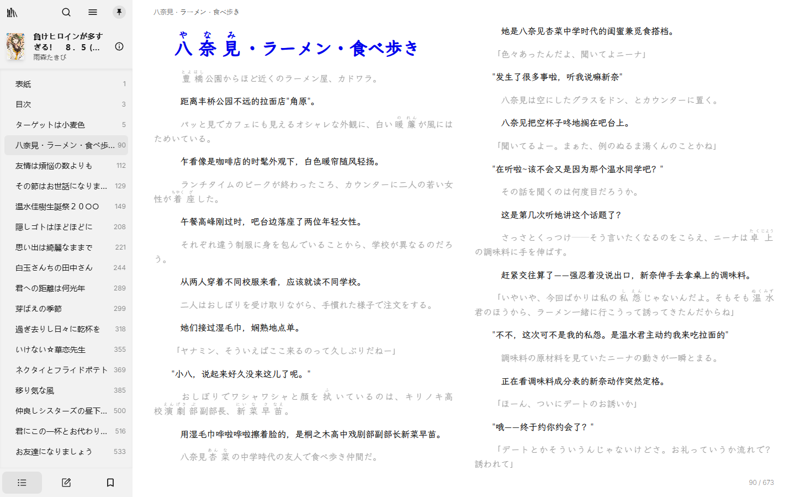
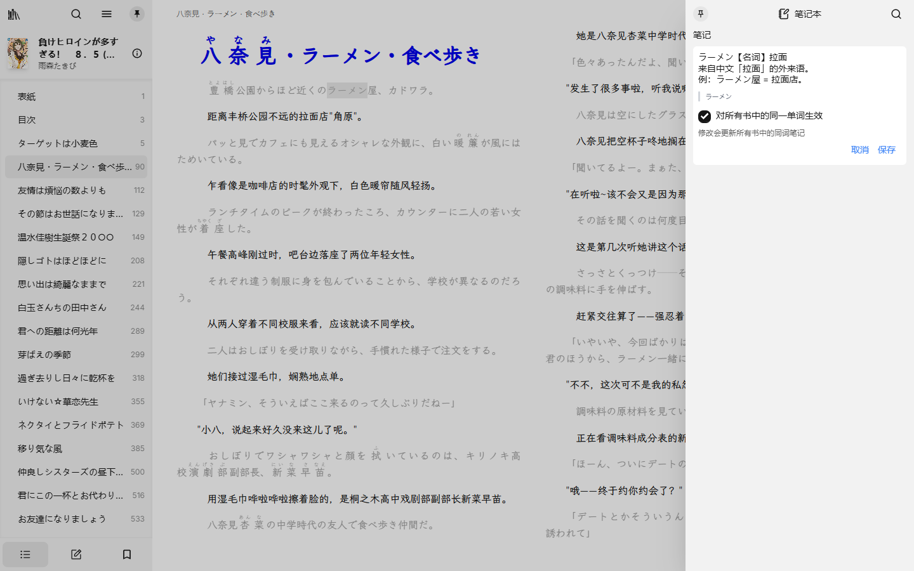
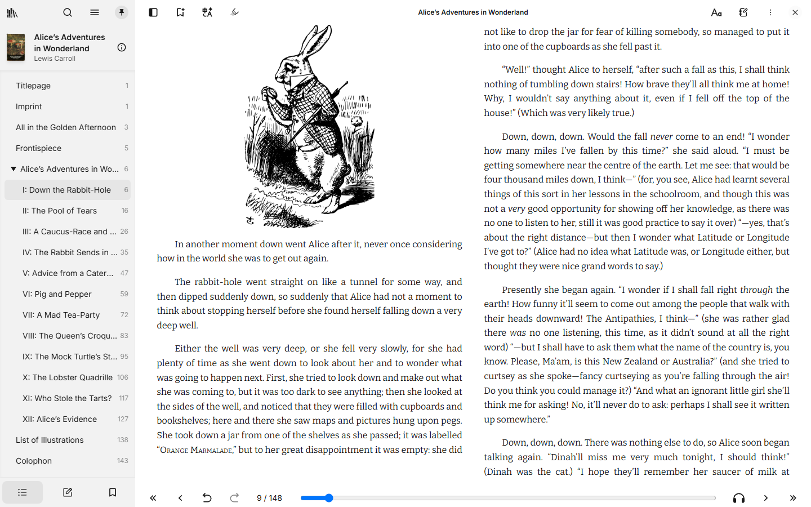
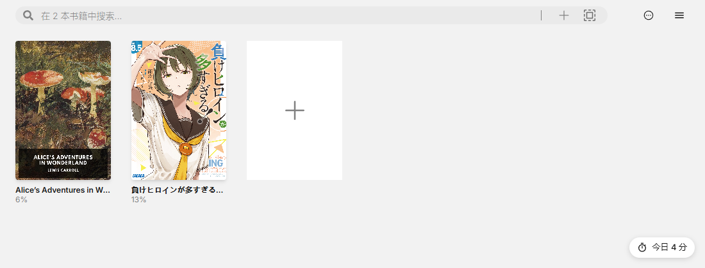

<div align="center">


<h1>KiriReadest</h1>

<p><strong>面向外语阅读与学习的开源电子书阅读器</strong></p>
<p>结合上下文理解原文，把单词笔记带到下一本书。</p>

<p>
  <a href="LICENSE"></a>
  
  
</p>

<p>
  <a href="https://github.com/kiri603/KiriReadest/releases"><strong>下载安装</strong></a> ·
  <a href="#特色功能">特色功能</a> ·
  <a href="#快速开始">快速开始</a> ·
  <a href="https://github.com/kiri603/KiriReadest/issues">问题反馈</a> ·
  <a href="CONTRIBUTING.md">参与贡献</a> ·
  <a href="#支持本项目">支持项目</a>
</p>



</div>

KiriReadest 适合希望通过小说、原版书积累外语词汇的读者。在继承多格式阅读、书库和批注能力的基础上，本项目重点加入了 **AI 语境释义、跨书单词笔记**，并改进了日文选词、翻页方向和 WebDAV 阅读进度同步。

基于 [OpenReadest](https://github.com/luyishui/OpenReadest) 和其上游 [Readest](https://github.com/readest/readest) 开发，按 [AGPL-3.0](LICENSE) 发布，由 KiriReadest 维护者独立维护，与上游项目无官方关联。

## 为什么选择 KiriReadest

| 阅读中遇到的问题                     | KiriReadest 的改进                                |
| ------------------------------------ | ------------------------------------------------- |
| 词典义项很多，难判断原文里的意思     | 把目标词、所在句与上下文一起交给 AI，解释当前语境 |
| 同一个词换本书又要重新记笔记         | 保存为跨书词条，在其他书中自动标记并查看同一释义  |
| 日文注音干扰选词，翻页方向不顺手     | 查词时排除 ruby 注音，翻页方向与正文排版分别设置  |
| 换设备阅读或回翻后，进度被旧位置覆盖 | 按实际阅读时间合并 WebDAV 进度，修复同步触发时机  |

## 特色功能

### AI 语境释义

选中单词或短语，结合**所在句、上一句和段落**获取当前语境中的释义、词性、整句译文与判断依据。选中整句或长文本时，则提供结合上下文的翻译。

例如《Alice’s Adventures in Wonderland》开篇的 “sitting by her sister on the bank”，这里需要理解的是河岸语境。AI 功能将上下文一并提供给模型，帮助判断具体义项。

- 自选服务地址、API Key 与模型，提供 DeepSeek、OpenAI、Ollama 预设。
- 支持 OpenAI 兼容端点、获取模型列表、手动指定模型和测试连接。
- 未配置或请求失败时尝试机器翻译，并显示结果来源。

<details>
<summary>查看 AI 配置界面与接入说明</summary>

<p align="center">
  
</p>

进入「设置 → 语言 → AI 语境释义」，填写配置并测试连接。图中展示配置界面，未使用模拟 AI 回答。

自定义服务需兼容 /chat/completions，并使用 Bearer Key 鉴权。模型列表通过 GET /models 获取，端点不支持时可手动填写。目前不支持自定义请求头。

浏览器版受 CORS 限制；本机 Ollama 可使用 http://127.0.0.1:11434/v1，并将 OLLAMA_ORIGINS 限定为实际页面来源，例如 http://localhost:3000。桌面版通过 Tauri HTTP 插件请求。

AI 服务由你自行选择，可能产生服务商费用。模型解释可能出错，请结合原文核对。

</details>

### 跨书单词笔记

**记过一次，在下一本书里继续使用。** 选词后打开「笔记」，录入发音和释义，勾选「对所有书中的同一单词生效」。在当前书或其他书中遇到匹配文字时，阅读器会加下划线，点击即可查看、编辑同一词条。



- 英文按完整单词匹配并忽略大小写，read 不会误匹配 reader；保留重音差别。
- 中日韩文字按选中文字匹配，支持行内标签拆分的正文与动态翻译内容。
- 日文匹配时忽略 ruby 注音，避免把汉字和读音拼成错误词条。
- 可取消跨书生效并保留原位置笔记，也可删除词条及其关联笔记与高光。

> WebDAV 可同步书内原位置笔记和跨书词条库。多设备的词条会自动合并，取消跨书生效或删除词条也会同步；同一词条的释义冲突采用较新的修改。扫描图片无法直接匹配词条。

### 更适合日文阅读

查词与 AI 语境提取会排除 ruby 的 rt、rp、rtc 注音节点，只使用正文；原有假名仍会保留。

翻页方向可选择「跟随排版」「从右向左（日式）」或「从左向右」。默认竖排采用日式翻页，也可自行调整，不改变正文列序。排版模式支持全局默认与单书设置。

首屏截图展示实际 EPUB 中的 ruby 注音与中日对照。对照译文由该 EPUB 提供，不是 AI 实时生成的内容。

### 更可靠的 WebDAV 阅读进度

在前作的 WebDAV 同步基础上，修复多设备切换、回翻和重新分页时的进度处理。

| 场景                               | 本项目的处理                             |
| ---------------------------------- | ---------------------------------------- |
| 回到前面章节重新阅读               | 按最近实际阅读时间合并，允许进度向前回退 |
| 修改字体、排版或重新分页           | 不将重新计算的位置当作一次新的阅读操作   |
| 启动、回到前台、网络恢复、打开书籍 | 检查远端变化，书库与阅读页均参与自动同步 |
| 切到后台或窗口失焦                 | 尝试保存并上传最新进度                   |

两端需使用同一 WebDAV 配置和包含修复的版本。自动同步依赖网络与应用运行状态，系统挂起或关闭应用后不会持续执行。

### 免账号翻译与朗读

机器翻译使用 Google 翻译。翻译和设备朗读无需项目账号。

**Google 翻译不可用时**，请检查代理是否已连接，以及 KiriReadest 是否在代理范围内。若规则模式下翻译失败，可临时切换到全局模式测试。若全局模式可用，请检查规则模式是否将 `translate.googleapis.com` 的请求发往代理。

Windows 设备朗读使用系统 SAPI 音色，Android 使用系统 TTS，其他平台使用浏览器语音；也可选择 Edge 在线音色。朗读面板可按语言筛选，或跟随双语阅读设置朗读原文、译文。

<details>
<summary>朗读的离线能力与语言识别范围</summary>

设备语音能否离线使用取决于已安装的语言包。Edge 语音由微软服务器合成，需要联网；应用未打包离线语音模型。

语言筛选优先使用正文语言标签，无法可靠区分没有标签的纯汉字中日文或逐词拆分混排文本。

</details>

## 阅读与书库

保留上游的阅读能力，支持 EPUB、PDF、MOBI、AZW/AZW3、FB2、CBZ、TXT 等格式，以及高光、批注、书签、全文搜索、笔记导出、阅读统计和 WebDAV 同步。字体、主题、横排与竖排、分页与滚动、自定义 CSS、并排阅读均可按习惯调整。不同格式的排版与交互支持有所差异。

<details>
<summary>查看英文阅读与书库实拍</summary>





截图均来自本地浏览器版实际界面，桌面与移动端会随屏幕大小调整布局。

- 英文书籍为 Lewis Carroll 的《Alice’s Adventures in Wonderland》，John Tenniel 插图，使用 [Standard Ebooks 版本](https://standardebooks.org/ebooks/lewis-carroll/alices-adventures-in-wonderland/john-tenniel)。
- 日文书籍为雨森たきび的《負けヒロインが多すぎる！ 8.5》，いみぎむる插画。正文、译文和封面版权归各自权利人所有。
- 书籍仅用于展示实际阅读效果，不随软件分发；单词笔记为演示时手工录入。

</details>

## 下载与安装

**[下载安装与版本说明](https://github.com/kiri603/KiriReadest/releases/latest)**

| 平台 | 安装包 |
| --- | --- |
| Windows x64 | [下载 .exe 安装程序](https://github.com/kiri603/KiriReadest/releases/download/v0.9.102/KiriReadest_0.9.102_x64-setup.exe) |
| Android 7.0+（ARM64） | [下载 .apk 安装包](https://github.com/kiri603/KiriReadest/releases/download/v0.9.102/KiriReadest_0.9.102_arm64.apk) |

其他平台的构建方式见下方开发说明。

升级前请备份本地书库与设置。当前保留旧版内部应用 ID 和数据目录以兼容已有数据，更改产品名不会自动隔离旧数据。本项目不提供原 Readest 的账号、托管云空间或付费订阅服务。

## 快速开始

1. **导入书籍。** 在书库点击「＋」，选择本地 EPUB 或其他支持的文件。
2. **配置阅读方式。** 打开书籍，在「字体和布局」中设置字号、排版与翻页方向。
3. **开启 AI 释义。** 在「设置 → 语言 → AI 语境释义」中配置服务并测试连接，然后回到书中选词。
4. **积累词条。** 选词后打开「笔记」，勾选跨书生效，保存自己的发音与释义。
5. **按需同步。** 在书库菜单的「WebDAV」中配置服务器，不同设备填写相同配置。

<details>
<summary>WebDAV 配置与同步范围</summary>

填写服务器地址、远端路径、用户名与密码，测试连接后保存。按需选择上传、下载或自动同步。

请使用专门的远端路径，已有书库保持原路径不变。为兼容旧数据，内部仍沿用历史命名的同步子目录。

| 数据                                     | 当前 WebDAV 同步范围 |
| ---------------------------------------- | -------------------- |
| 书籍、阅读进度、书内原位置笔记与阅读配置 | 支持                 |
| 跨书词条库的自动匹配数据、释义与删除记录 | 支持，自动合并       |

跨书词条随手动和自动同步一起处理，原有本地词条会在首次同步时上传。所有参与词条同步的设备都需要使用支持此功能的版本。服务器若不提供强 ETag，并发写入的变更可能延迟到下一次同步后收敛。

</details>

<details>
<summary>数据存储与外部请求</summary>

- 书籍、设置与跨书词条保存在本机；配置 WebDAV 后，参与同步的数据发送到指定服务器。
- AI Key 保存在本机应用设置中，请勿公开设置文件。请求包含选中文字、相关句子、段落和语言信息，直接发送到所配置的服务。
- 机器翻译和 Edge 在线朗读会将相关文本发送到对应服务商。
- 原版遥测、错误上报与 Discord Rich Presence 已移除。

</details>

## 开发与贡献

欢迎在 [Issues](https://github.com/kiri603/KiriReadest/issues) 报告问题、讨论功能，或提交修复、翻译与文档改进。反馈时请附版本、平台和复现步骤。提交前请阅读 [贡献指南](CONTRIBUTING.md)。

<details>
<summary>从源码运行、原生构建与测试</summary>

推荐 Node.js 22 与 pnpm 10。保留原来的工作区目录和包名是为了沿用现有构建配置，因此下方仍使用 `apps/openreadest-app` 与 `@openreadest/app`。

```powershell
git clone https://github.com/kiri603/KiriReadest.git
cd KiriReadest
Copy-Item apps/openreadest-app/.env.example apps/openreadest-app/.env
git submodule update --init --depth 1 packages/simplecc-wasm apps/openreadest-app/src-tauri/plugins/tauri-plugin-turso
corepack pnpm@10.14.0 install --frozen-lockfile
corepack pnpm@10.14.0 --filter @openreadest/app run prepare-public-vendor
corepack pnpm@10.14.0 --filter @openreadest/app run copy-simplecc
corepack pnpm@10.14.0 --filter @openreadest/app run copy-pdfjs-js
corepack pnpm@10.14.0 --filter @openreadest/app run copy-pdfjs-wasm
corepack pnpm@10.14.0 --filter @openreadest/app run copy-pdfjs-fonts
corepack pnpm@10.14.0 --filter @openreadest/app run copy-flatten-pdfjs-annotation-layer-css
corepack pnpm@10.14.0 --filter @openreadest/app run copy-flatten-pdfjs-text-layer-css
corepack pnpm@10.14.0 --filter @openreadest/app dev-web
```

打开 [http://localhost:3000](http://localhost:3000)。如本机已有 pnpm 10，也可使用现有的 `setup-vendors` 脚本准备资源。原生构建还需要 Rust、Tauri 及对应平台依赖；需要构建 Tauri 和插件源码时，另行初始化 `packages/tauri` 与 `packages/tauri-plugins` 子模块。

运行相关测试：

```powershell
corepack pnpm@10.14.0 --filter @openreadest/app test src/tests/brandTranslations.test.ts src/tests/ai.test.ts src/tests/translationContext.test.ts src/tests/wordNotes.test.ts src/tests/wordNotesPersistence.test.ts src/tests/readingLayout.test.ts src/tests/pageTurnDirection.test.ts src/tests/webdavProgress.test.ts
```

</details>

## 支持本项目

如果 KiriReadest 帮助你阅读原版书、积累外语词汇，欢迎通过支付宝支持项目的持续维护与开发。捐赠完全自愿，感谢你的支持。

<p align="center">
  
</p>

使用支付宝扫一扫，或保存图片后从相册识别。应用内也可通过「书库 → 设置菜单 → 支持 KiriReadest」查看收款码。报告问题、提交改进和分享使用经验，同样是对项目的支持。

## 致谢与许可

感谢 [LINUX DO](https://linux.do/) 为开源项目提供交流空间。

KiriReadest 基于 [OpenReadest](https://github.com/luyishui/OpenReadest) 和 [Readest](https://github.com/readest/readest) 开发。感谢两代项目的作者和贡献者，来源与修改记录见 [NOTICE.md](NOTICE.md)。

| 项目        | 贡献归属                                                  |
| ----------- | --------------------------------------------------------- |
| Readest     | 原始代码版权归 Bilingify LLC 与 Readest 贡献者所有        |
| OpenReadest | 继承的新增与修改部分版权归 luyishui 及对应贡献者所有      |
| KiriReadest | 本项目原创的新增与修改部分版权归 kiri603 及对应贡献者所有 |

本项目不对继承代码重新主张版权。感谢 Tauri、tauri-plugins、foliate-js、simplecc-wasm、OpenCC、PDF.js 等组件及其贡献者，各组件保留自己的许可证与署名。

本项目按 [GNU AGPL-3.0](LICENSE) 发布。分发时请保留许可证、来源与第三方声明，记录修改，并提供与发行版对应的完整源码及必要构建材料。提供可远程交互的修改版服务时，也需遵守相应的源码提供要求。书籍截图中的内容不因本项目许可证而改变原有版权归属。
